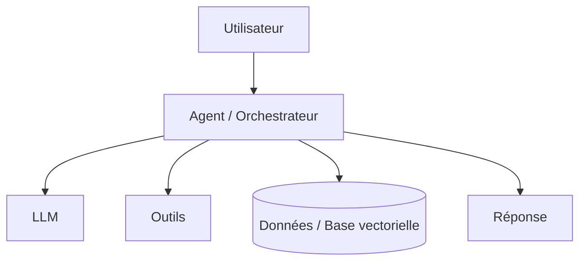

# Fiche de cadrage du projet

**Cours** : Développement et déploiement d'applications intelligentes **Projet d'agent IA en binôme**

> **Consignes générales**

> - Remplissez chaque section de ce document. Les consignes en italique indiquent ce qui est attendu.  
> - Nommez le fichier selon la convention : `NomBinome_ProjetXX.md` (exemple : `Larhlimi-Benali_Projet07.md`).  
> - Le document est à remettre avec le dataset (fichier CSV joint ou lien fonctionnel) et la maquette.  
> - Les réponses courtes ou de type oui/non ne sont pas acceptées dans le questionnaire de la section 8\.

---

## 1\. Identification du binôme

*Indiquez les informations de chaque membre. Le groupe correspond à votre section de cours.*

|  | Membre 1 | Membre 2 |
| :---- | :---- | :---- |
| Nom |  |  |
| Prénom |  |  |
| Adresse courriel |  |  |
| Groupe / Section |  |  |

---

## 2\. Projet choisi

*Reportez le numéro et l'intitulé exact du projet tel qu'il apparaît dans la liste des 40 projets (`projets-agents-ia.md`).*

- **Numéro du projet** :  
- **Intitulé du projet** :  
- **Type** : ☐ Informatique (1 à 20\)  ☐ Industriel (21 à 40\)  
- **Catégorie** (ex. : Sécurité, Génie logiciel, Maintenance industrielle) :

---

## 3\. Descriptif proposé

*Entre 150 et 300 mots. Décrivez le problème à résoudre, les utilisateurs cibles, les fonctionnalités principales de l'agent et le périmètre retenu pour le cours. Soyez précis sur ce qui sera réalisé et sur ce qui ne le sera pas.*

**Problème à résoudre**

*(à compléter)*

**Utilisateurs cibles**

*(à compléter)*

**Fonctionnalités principales de l'agent**

1\. 2\. 3\. 4\.

**Périmètre retenu pour le cours**

| Inclus dans le projet | Exclu du projet (hors périmètre) |
| :---- | :---- |
|  |  |
|  |  |
|  |  |

---

## 4\. Dataset

*Indiquez le jeu de données que l'agent utilisera (documents, logs, tickets, mesures capteurs, etc.). Joignez le fichier CSV ou fournissez un lien fonctionnel. Si les données sont générées ou simulées, expliquez la méthode de génération.*

| Élément | Réponse |
| :---- | :---- |
| Nom du fichier CSV joint ou lien |  |
| Source (site, organisme, génération propre) |  |
| Taille approximative (lignes, colonnes, Mo) |  |
| Licence ou conditions d'utilisation |  |
| Format des données (CSV, JSON, PDF, logs, images) |  |

**Description des colonnes ou champs principaux**

| Colonne / Champ | Type | Description | Exemple de valeur |
| :---- | :---- | :---- | :---- |
|  |  |  |  |
|  |  |  |  |
|  |  |  |  |
|  |  |  |  |

**Si les données sont générées ou simulées, décrivez la méthode :**

*(à compléter)*

---

## 5\. Proposition de maquette

*Décrivez l'interface ou le flux d'interaction avec l'agent : écrans, entrées de l'utilisateur, sorties de l'agent. Joignez un schéma ou un lien vers une maquette (Figma, image, dessin scanné). Ajoutez également un schéma d'architecture simplifié de l'agent.*

### 5.1 Interface et flux d'interaction

**Type d'interface** : ☐ Application web  ☐ Interface en ligne de commande  ☐ API  ☐ Chatbot (Slack, Teams, etc.)  ☐ Tableau de bord  ☐ Autre :

**Écrans ou étapes principales**

| Écran / Étape | Ce que l'utilisateur fait (entrée) | Ce que l'agent renvoie (sortie) |
| :---- | :---- | :---- |
| 1\. |  |  |
| 2\. |  |  |
| 3\. |  |  |

**Lien ou fichier de la maquette** :

### 5.2 Schéma d'architecture de l'agent

*Représentez les composants principaux : utilisateur, orchestrateur ou agent, LLM, outils appelés, base de données ou base vectorielle, sources de données. Vous pouvez utiliser un bloc Mermaid, un schéma ASCII ou une image.*

&nbsp;

**Explication du schéma**

*(à compléter)*

---

## 6\. Technologies et outils

*Complétez les deux tableaux. Chaque ligne doit comporter une justification courte du choix. Les deux volets (développement et déploiement) sont obligatoires.*

### 6.1 Développement

| Catégorie | Outil ou technologie choisi | Justification du choix |
| :---- | :---- | :---- |
| Langage de programmation |  |  |
| Framework d'agents (LangChain, LlamaIndex, CrewAI, AutoGen, etc.) |  |  |
| Modèle LLM (fournisseur et modèle) |  |  |
| Base vectorielle (si RAG) |  |  |
| Bibliothèques principales |  |  |
| Outils de test |  |  |
| Gestion de version (Git, plateforme) |  |  |

### 6.2 Déploiement

| Catégorie | Outil ou technologie choisi | Justification du choix |
| :---- | :---- | :---- |
| Conteneurisation (Docker, etc.) |  |  |
| Hébergement (cloud, serveur, local) |  |  |
| CI/CD |  |  |
| Monitoring et journalisation |  |  |
| Gestion des secrets et clés API |  |  |
| Exposition de l'application (API, interface web) |  |  |

---

## 7\. Répartition des tâches et calendrier

*Indiquez qui fait quoi et les principales étapes jusqu'à la remise finale.*

| Étape | Responsable (Membre 1 / Membre 2 / Les deux) | Date de début | Date de fin | Livrable |
| :---- | :---- | :---- | :---- | :---- |
| Cadrage et choix des données |  |  |  | Cette fiche |
| Préparation du dataset |  |  |  |  |
| Développement du cœur de l'agent |  |  |  |  |
| Intégration des outils et de la mémoire |  |  |  |  |
| Interface utilisateur |  |  |  |  |
| Tests et évaluation |  |  |  |  |
| Conteneurisation et déploiement |  |  |  |  |
| Documentation et présentation |  |  |  |  |

---

## 8\. Questionnaire de cadrage

*Répondez à chacune des 15 questions de façon détaillée (plusieurs phrases par réponse). Ces réponses serviront de base à l'évaluation de la compréhension du projet.*

### Compréhension du besoin

**Q1. Quel problème concret votre agent résout-il, et comment ce problème est-il traité aujourd'hui sans agent IA ?**

*(réponse)*

**Q2. Qui est l'utilisateur final de votre agent, et comment interagit-il avec lui au quotidien ?**

*(réponse)*

**Q3. Quelle valeur ajoutée apporte l'agent par rapport à une solution classique (script, règles fixes, recherche manuelle) ?**

*(réponse)*

### Raisonnement et comportement de l'agent

**Q4. Quelles sont les entrées de l'agent et quelles sorties produit-il ? Donnez un exemple complet d'interaction.**

*(réponse)*

**Q5. Quelles décisions l'agent prend-il de façon autonome, et quels outils externes appelle-t-il pour y parvenir (recherche, base de données, exécution de code, API) ?**

*(réponse)*

**Q6. Quel type de mémoire votre agent utilise-t-il (contexte de conversation, mémoire à long terme, base vectorielle) et pourquoi ?**

*(réponse)*

### Données

**Q7. Décrivez la qualité de vos données : valeurs manquantes, bruit, déséquilibre, biais potentiels. Quelles étapes de préparation sont prévues ?**

*(réponse)*

**Q8. Quelles sont les limites de votre dataset, et comment ces limites influencent-elles les résultats attendus de l'agent ?**

*(réponse)*

### Architecture et choix techniques

**Q9. Justifiez le choix de votre framework d'agents et de votre modèle LLM. Quelles alternatives avez-vous écartées et pourquoi ?**

*(réponse)*

**Q10. Comment votre architecture gère-t-elle les erreurs (outil indisponible, réponse du LLM incohérente, données manquantes) ?**

*(réponse)*

### Déploiement

**Q11. Décrivez l'environnement de déploiement cible. Comment un utilisateur accède-t-il à l'agent une fois déployé ?**

*(réponse)*

**Q12. Quels sont les coûts d'exploitation attendus (appels au LLM, hébergement, stockage) et comment comptez-vous les maîtriser ? Que se passe-t-il si le nombre d'utilisateurs augmente ?**

*(réponse)*

### Évaluation

**Q13. Quelles métriques utiliserez-vous pour évaluer votre agent (exactitude, pertinence des réponses, temps de réponse, taux de résolution) et quel est votre critère de réussite ?**

*(réponse)*

**Q14. Quels tests prévoyez-vous (tests unitaires, scénarios de bout en bout, jeu de questions de référence) et comment seront-ils automatisés ?**

*(réponse)*

### Risques

**Q15. Identifiez les principaux risques de votre projet (hallucinations, sécurité, fuite de données, éthique, dépendance aux API externes) et décrivez les mesures prévues pour chacun.**

*(réponse)*

---

## 9\. Liste de vérification avant de remettre

- [ ] Le fichier est nommé selon la convention `NomBinome_ProjetXX.md`  
- [ ] Les informations des deux membres et le groupe sont renseignés  
- [ ] Le numéro et l'intitulé du projet correspondent exactement à la liste officielle  
- [ ] Le descriptif fait entre 150 et 300 mots et précise le périmètre  
- [ ] Le dataset est joint (CSV) ou le lien est fonctionnel, avec description des colonnes  
- [ ] La maquette est incluse (lien ou image) ainsi que le schéma d'architecture  
- [ ] Les deux tableaux de technologies (développement et déploiement) sont remplis avec justifications  
- [ ] La répartition des tâches et le calendrier sont complétés  
- [ ] Les 15 questions ont reçu une réponse détaillée  
- [ ] Le document a été relu par les deux membres du binôme
